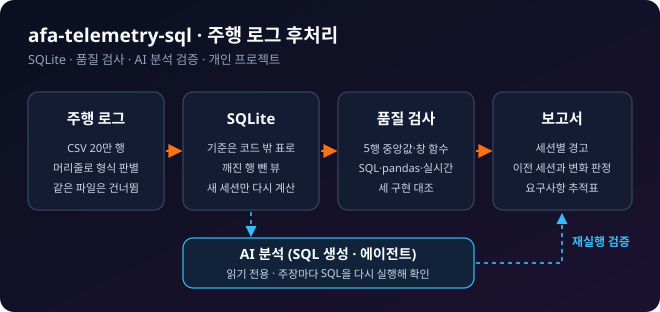
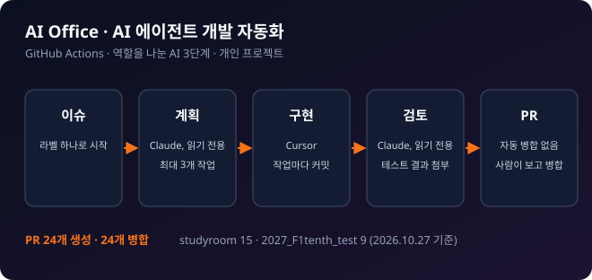
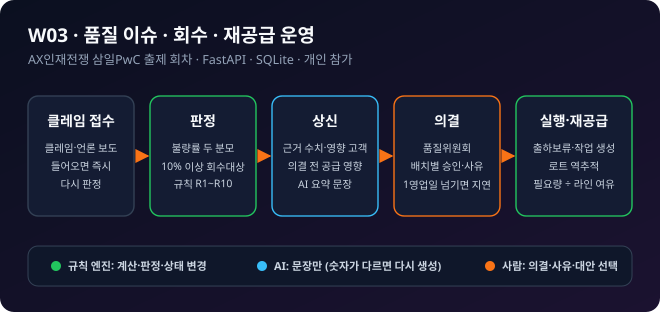
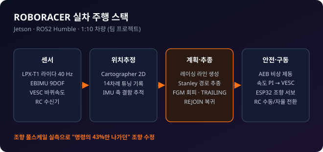
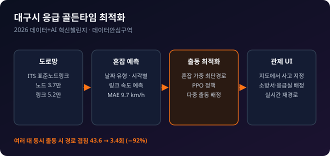
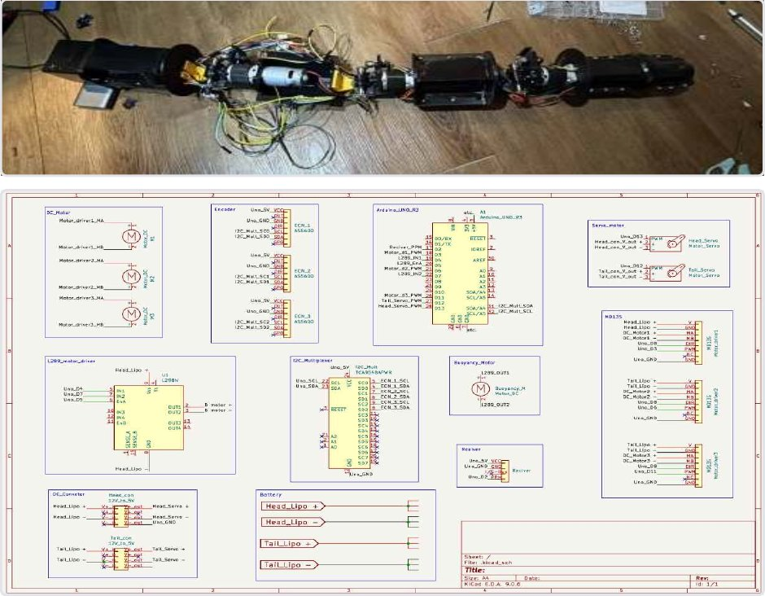
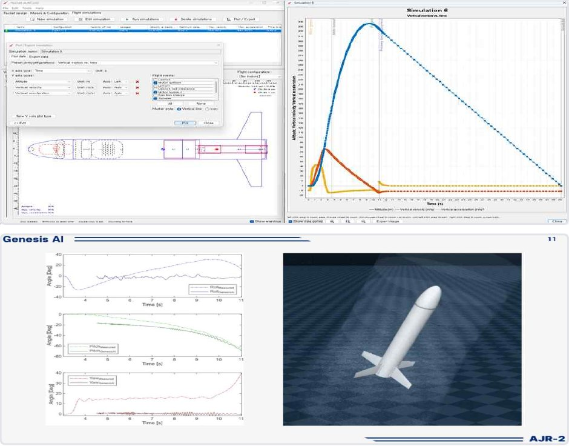
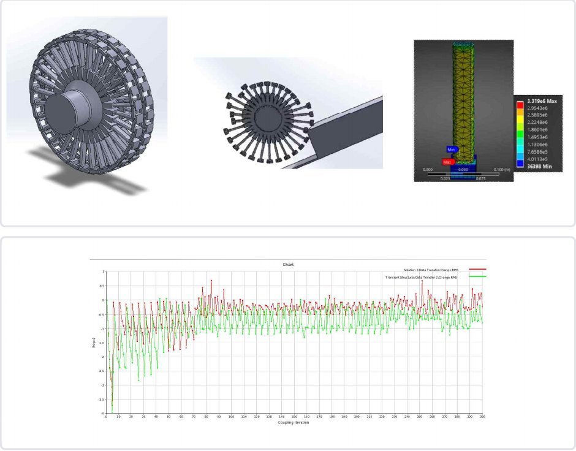

  

  <b>아주대학교 기계공학과 / 학사</b> · 2027.08 졸업예정 
  <b>2026.12.22부터 근무 가능</b> · 2027-1학기 취업계 가능

  

  

 

## 🔧 Projects

<table>
<tr>
<td colspan="2" valign="top">

### 🏟️ [공공 스포츠강좌 찾기 · 공공데이터 건강검진](https://github.com/tkddn647-ship-it/kspo-opendata-check)
2026 한국체육산업개발 공공데이터 활용 경진대회 출품 · 개인 · 기획·데이터 수집·결과 검증 (코드는 Claude Code로 작성)

센터 4곳의 형식이 다른 강좌 파일을 한 형식으로 모으고, 기관이 개방한 데이터의 품질을 같은 규칙으로 점검하는 시민·기관용 화면. [페이지 보기](https://tkddn647-ship-it.github.io/kspo-opendata-check/)

- 개방 데이터 **58종**(파일 30 · API 28) 규칙 점검: 점검 필요 2 · 주의 14 · 양호 42, 데이터마다 고치는 방법 제시 (판정에 AI 미사용)
- 종료일이 정해지지 않은 강좌 **2,303개**를 요일·시작 시각·대상으로 검색, 1년 넘게 바뀌지 않은 강좌는 '운영 여부 센터 확인' 표시
- **수집 자동화**: 매주 월요일 포털 수정일 확인 후 바뀐 파일만 갱신·배포, 내려받기 제한(보안문자) 시 우회하지 않고 갱신 중단·기존 자료 유지, 실시간 주차 API 30분 간격 기록
- 무작위 강좌 **100개를 Claude로 원본 기록과 대조**: 대상이 적힌 75개 모두 일치, 처방 연결 45개 오류 0, 대상이 빈 25개는 화면에 '가정' 표시

`Python` `SQLite` `GitHub Actions` `공공데이터 API` `Claude Code`

</td>
</tr>
<tr>
<td colspan="2" valign="top">

### 📊 [주행 로그 SQL 후처리와 데이터 품질 검증 · afa-telemetry-sql](https://github.com/tkddn647-ship-it/afa-telemetry-sql)
Data Engineering · SQL · Data Quality · 개인 프로젝트 (코드는 Claude Code로 작성)

경주차 DAQ로 모은 실주행 로그 **10세션 · 198,027행**을 SQLite로 옮겨 **품질 검사 → 원인 추적 → 자동 보고서**까지 이어지는 파이프라인. AI가 짠 SQL과 분석을 채점·재계산하는 장치도 함께.

- 결함 주입 시험으로 품질 규칙의 빈틈 발견 → 5행 중앙값 규칙으로 두 행 연속 튄 값 **0% → 99.5%**, 실제 로그 깨진 행 **88 → 610행**
- 같은 규칙을 **SQL · pandas · 실시간** 세 가지로 구현해 **1,319칸 일치** 대조, 처음 보는 로그 형식은 열 대응 표 한 장으로 적재
- 깨진 행과 빠진 샘플이 **0.106 비율**로 함께 움직임(10세션 상관 0.999) → 펌웨어 수정 효과를 세션 하나로 판정
- 규정 점검 SQL로 찾은 '프리차지 미달 6/6' → 펌웨어 대조로 **위반이 아니라 신호 정의 결함**임을 밝힘
- AI SQL 정답률 **8~10/17 → 16/17** (정답 셋 25문항, 3번 실행 범위로 보고), 분석 에이전트 주장은 SQL 재실행으로 확인

`SQL (SQLite)` `Python` `pandas` `GitHub Actions` `MCP` `Claude Code` · [설명 노트](https://github.com/tkddn647-ship-it/afa-telemetry-sql/blob/main/docs/explain.md)

</td>
</tr>
<tr>
<td width="50%" valign="top">

### 🤖 [AI Office · AI 에이전트 개발 자동화](https://github.com/tkddn647-ship-it/ai-office)
LLM Automation · GitHub Actions · 개인 프로젝트

이슈에 라벨 하나만 달면 **계획 → 구현 → 검토 → PR**까지 AI가 역할을 나눠 처리하는 개발 자동화. 기획·운영은 직접, 코드는 Claude Code·Cursor로 작성.

- 계획·검토 AI는 **읽기 전용**, 구현 AI만 코드 수정
- **자동 병합 없음**: 사람이 PR을 보고 병합
- 테스트를 직접 실행해 결과를 PR에 첨부, 리뷰에서 문제가 나오면 자동 수정 라운드
- 실제 레포 2곳에서 **PR 24개 생성 · 24개 병합** (2026.10.27 기준)
- 출처 검사 규칙: 없는 쪽을 출처로 쓰면 CI 실패 → AI가 원자료 밖 내용으로 만든 결과 **1건 적발**

`Python` `GitHub Actions` `Claude Code` `Cursor` `YAML`

</td>
<td width="50%" valign="top">

### ⚡ [AFA2026 차량 계측 시스템](https://github.com/tkddn647-ship-it/afa2026)
Formula Student · Embedded · Hardware · Server

전기차의 서스펜션·가속도·인버터/BMS·조향 데이터를 **STM32에서 한 타임라인으로 100 Hz 동기 수집**하고 실시간 대시보드·로깅·카메라 녹화까지 연결한 자작 데이터로거.

- 링 버퍼 + DMA 전송으로 수집 주기 **10 Hz → 100 Hz**
- 섀시 다이나모로 검증: 최고속도 계측 90 vs 87 km/h (**오차 약 3.4%**)
- 주행 영상과 로깅 데이터를 시간 동기화한 분석 화면
- **2인이 센서·통신·서버·분석 화면까지** 전 영역 설계·구축
- 주행 로그 25세션 · 약 178만 행을 온보드 영상 15개로 검증 → 0.2초마다 반복되던 **주기적 누락 5%** 원인을 서버 저장 필터에서 찾아 수정 (재현 시험 5.0% → 0, 실차 검증 전) · [분석 문서](https://github.com/tkddn647-ship-it/afa2026/tree/main/analysis)

`C` `STM32` `CAN` `Raspberry Pi` `FastAPI`
 이 데이터의 SQL 분석: [afa-telemetry-sql](https://github.com/tkddn647-ship-it/afa-telemetry-sql)

</td>
</tr>
<tr>
<td colspan="2" valign="top">

### 🧴 [품질 이슈·회수·재공급 운영 시스템 · AX인재전쟁](https://github.com/tkddn647-ship-it/w03-quality-recall)
AX인재전쟁 온라인 1회차 삼일PwC 과제 · 개인 참가 · 🏆 참가자 2,916명 중 상위 10% ([상위 10% 인증](./assets/w03_top10.jpg) · [참가 인증서](https://axacademy.ai/axwar/cert/osuC8ynzaby4NMCG7BqfBLk_)) · 업무 규칙·판단 기준 설계와 검증 (코드는 Claude Code로 작성)

화장품 클레임과 언론 보도가 겹친 상황에서 **클레임 접수 → 회수대상 판정 → 품질위원회 의결 → 재공급 계획**을 하나로 잇는 웹 업무 시스템.

- 배치별 불량률을 생산량·출하량 **두 분모**로 다시 계산, 하나라도 10% 이상이면 회수대상 (규칙 10개 · 가정 32개를 설계 문서로 명시)
- **AI는 문장만**: 입력은 규칙 엔진 계산값뿐, 숫자가 다르거나 의결 전 결정처럼 읽히면 다시 생성, 실패하면 사람이 쓰는 경로
- 원료 **로트 역추적**으로 같은 로트 재고 **13,696EA**를 출하 전 추가검사로 묶고 재공급 계산에서 제외
- 대회 데이터: 회수대상 2개 배치, 재공급 필요량이 라인 여유의 **5.12배** → '대안 필요', 자동 테스트 **195개**

`Python` `FastAPI` `SQLite` `Pydantic` `Gemini API` `pytest` · [설계 문서](https://github.com/tkddn647-ship-it/w03-quality-recall/blob/main/DESIGN.md)

</td>
</tr>
<tr>
<td width="50%" valign="top">

### 🏎️ [지도 없이 달리는 레이싱카 강화학습](https://github.com/tkddn647-ship-it/2027_F1tenth_test)
Reinforcement Learning · Sim-to-Real

지도·위치추정 없이 **라이다·IMU·바퀴속도만으로** 조향과 속도를 내는 제어기를 강화학습으로 만들고, **Jetson 실차에 올려 주행**까지 연결.

- 40 Hz **비대칭 SAC** — critic만 레이싱 라인을 보고 학습
- 시뮬레이터 직접 구현: 1125빔 라이다, 서보·구동 지연, 브레이크 없는 구동계
- 시뮬 ifac **10.9 s** (pure pursuit 11.5 s, FTG 18.0 s)
- 초파리 **hemibrain 커넥톰** 배선을 메모리로 쓰는 정책 실험

`PyTorch` `SB3` `Gymnasium` `ROS2` `Jetson`

</td>
<td width="50%" valign="top">

### 🏁 [ROBORACER 실차 주행 스택](https://github.com/tkddn647-ship-it/f1tenth_ajou)
Robotics · ROS2 · 팀 프로젝트

1:10 자율주행 레이싱카의 **센서 → 위치추정 → 경로 계획·추종 → 안전·구동** 전 과정을 Jetson 위에 구축.

- Jetson·ROS2 환경 구축, 라이다·IMU·차체 TF Tree 설계
- Cartographer SLAM 튜닝, VESC 실측 기반 캘리브레이션
- 레이싱 라인 + Stanley 추종, FGM 장애물 회피
- 직선 구간 맵 압축 문제를 스캔 매칭 범위 조정으로 해결
- 🏆 **학교 최초 출전, 본선 진출**

`ROS2` `C++` `Python` `Cartographer` `Jetson`
 관련: [jetson_code](https://github.com/tkddn647-ship-it/jetson_code)

</td>
</tr>
<tr>
<td width="50%" valign="top">

### 🚑 [대구시 응급 골든타임 최적화](https://github.com/tkddn647-ship-it/Data_center)
Data + AI · 2026 데이터+AI 혁신챌린지

시간대별 혼잡을 예측해 **119 소방·구급 출동 경로를 최적화**하는 중앙관제 시뮬레이터.

- ITS 표준노드링크 도로망 **노드 3.7만 · 링크 5.2만**
- 혼잡 가중 최단경로 + PPO, 소방서·응급실 자동 배정
- 다중 출동 경로 겹침 **43.6 → 3.4회 (−92%)**
- 웹 관제 UI: 지도에서 사고 지정 → 실시간 재경로

`Python` `NetworkX` `PPO` `Flask` `Leaflet`

</td>
<td width="50%" valign="top">

### 🐍 수중형 장어로봇 다관절 제어
졸업작품 · Mechanism · Electronics · Firmware

5개 세그먼트가 파동형으로 움직이는 수중 장어로봇. **헤드 기구 설계부터 전기 배선, MCU 펌웨어, 제어기까지** 담당.

- 세그먼트 증가로 인한 I2C 주소 부족 → **I2C 멀티플렉서**로 해결
- PID로 모터 각속도 안정화, 세그먼트 간 위상차 유지로 파동 운동
- RC 조종기 스로틀 입력으로 직접 조작하는 인터페이스
- SolidWorks 헤드부 설계 → 3D 프린팅

`SolidWorks` `KiCad` `MCU Firmware` `PID` `I2C`

</td>
</tr>
<tr>
<td width="50%" valign="top">

### 🚀 [시뮬레이션–실측 기반 로켓 설계](https://github.com/tkddn647-ship-it/AJR-2_rocket)
로켓 동아리 · 🏆 2025 전국대학교로켓 학술대회·발사대회 수상

무게중심–압력중심 관계로 핀·노즈콘을 설계하고, **실측 추력으로 시뮬레이션을 보정**해 목표 고도에 근접한 안정적 발사.

- OpenRocket으로 형상 비교, 핀은 SolidWorks 설계 → 3D 프린팅
- 대회용 연료·노즐 추력을 **로드셀로 직접 측정**해 추력곡선 반영
- Genesis AI 가상 비행 → 실측 Roll·Pitch·Yaw와 비교 분석
- OpenRocket 결과를 운동방정식 직접 적분으로 재검증 (최고고도 차이 4~5%)

`OpenRocket` `SolidWorks` `Genesis AI` `Load Cell`

</td>
<td width="50%" valign="top">

### 🛞 가변 형상 바퀴 양방향 FSI 해석
융합설계 (5인 팀 · FSI 개인 수행)

팀이 스프링·감쇠로 단순화한 유체 감쇠 가정을 검증하기 위해 **유동–구조 해석을 연결한 양방향 FSI** 구성.

- 바퀴 내부를 비압축성 유체 영역으로 추출, 스포크 양방향 변형 허용
- 결과: 강성 목표의 약 6배, 감쇠 약 1/10
- 원인을 경계조건·메쉬 품질·연성 수렴으로 분석 → 실제 단차 조건 재해석 방향 도출

`Ansys CFX` `Transient Structural` `System Coupling`

</td>
</tr>
<tr>
<td colspan="2" valign="top">

### 💼 Experience & Awards

**무브와이즈랩 · 인턴 연구원** 2026.08 ~ 재직중 
카메라 기반 Costmap 설계 · 위험/안전 구역 기준 정의

**🏆 AX인재전쟁 온라인 1회차 (삼일PwC 과제) · 2,916명 중 상위 10%** 2026.11

**🏆 전국대학교로켓 학술대회·발사대회 수상** 2025.08

**🏁 ROBORACER · 학교 최초 출전 본선 진출**

**헬스 동아리 '득근득근' 창립·부회장** 2025.09 ~ 현재

**아주대학교 기계공학과** 2021.03 ~ 2027.08 (졸업예정)

</td>
</tr>
</table>

 

## 🧰 What I Work With

| 분야 | 사용 기술 |
|---|---|
| 🗄️ 데이터 엔지니어링 | SQL (SQLite: 창 함수 · CTE · gaps-and-islands), 데이터 품질 검사 · 결함 주입 시험, 증분 적재 · 로그 형식 대응, pandas, GitHub Actions CI, MCP 서버 |
| 🤖 로보틱스·자율주행 | ROS2 Humble, Cartographer, Stanley / Pure Pursuit, Follow-the-Gap, NVIDIA Jetson |
| 🧠 강화학습·AI | PyTorch, Stable-Baselines3 (SAC · PPO), Gymnasium, TorchScript / ONNX |
| 🔌 임베디드·하드웨어 | STM32 HAL · DMA, CAN, UART · SPI · I2C · ADC, ESP32, VESC, Raspberry Pi 5, KiCad |
| 🛠️ 기계 설계·해석 | SolidWorks, 3D 프린팅, Ansys CFX · Mechanical · System Coupling, OpenRocket, Genesis AI, MATLAB |
| 🧩 LLM 업무 자동화 | Claude Code, Cursor CLI, GitHub Actions, Gemini API, 출처 검사·테스트 자동 실행 |
| 🌐 서버·GIS | Flask, FastAPI, UDP/TCP, AWS, NetworkX, GIS(ITS 표준노드링크, Leaflet) |

 

  

